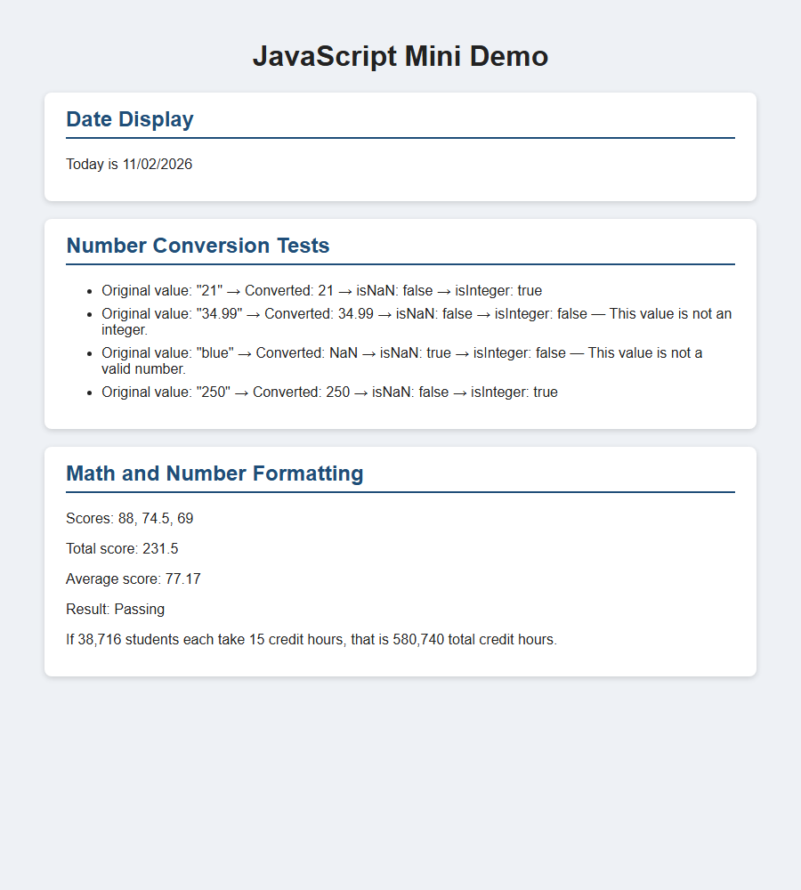

# Homework 9: JavaScript Built-In Objects

CIT 384 — JavaScript Mini Demo

## GitHub Pages Link

Live site: https://jonathanmacmillan446-web.github.io/CIT-384-HW-9/

## Screenshot

Screenshot of the finished page: [`screenshot.png`](screenshot.png)

## Built-In Objects and Methods Used

**`Date` object**
- `new Date()`
- `getMonth()`
- `getDate()`
- `getFullYear()`

**`Number` object**
- `Number()`
- `Number.isNaN()`
- `Number.isInteger()`
- `toFixed()`
- `toLocaleString()`

**`document` (DOM)**
- `document.getElementById()`
- `innerHTML`

## Extra Credit

I chose the CSS option: `style.css` gives each section a white card with a border.

## Reflection

The easiest part was showing the date since the `Date` object already has methods to get the month, day, and year. The most difficult part was managing all the different variables when converting numbers without being able to use arrays or loops. I learned that `getMonth()` starts at 0, so I needed to add 1 to get the correct month, and I used `if/else` statements to make sure the month and day always had two digits. Another thing I learned was that `Number()` gives `NaN` when the input isn't a valid number, and `Number.isNaN()` and `Number.isInteger()` help check the input. I also learned how to use `innerHTML` to display results directly on the webpage instead of just in the console.

## Sources

- MDN Web Docs: [Date](https://developer.mozilla.org/en-US/docs/Web/JavaScript/Reference/Global_Objects/Date), [Number](https://developer.mozilla.org/en-US/docs/Web/JavaScript/Reference/Global_Objects/Number)
